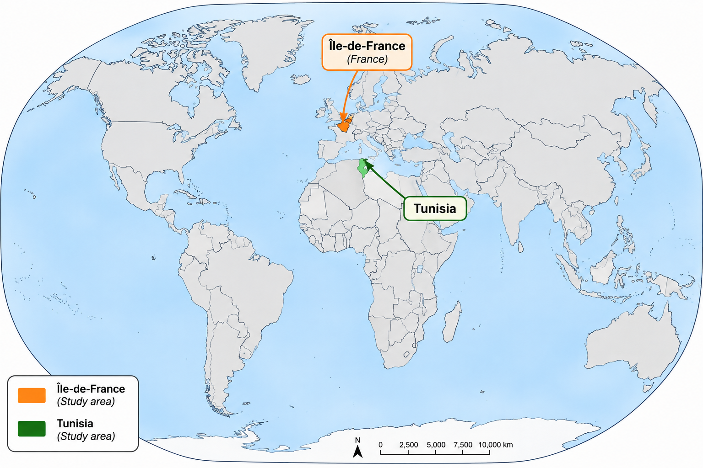
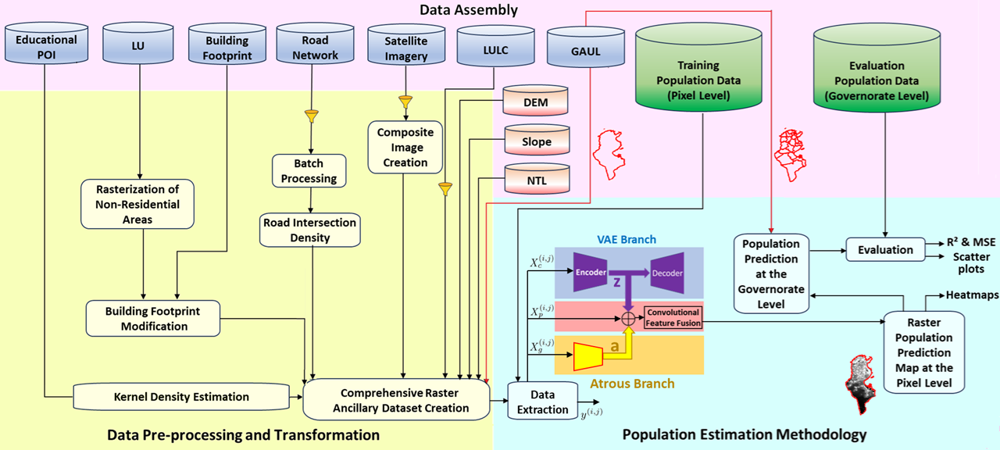
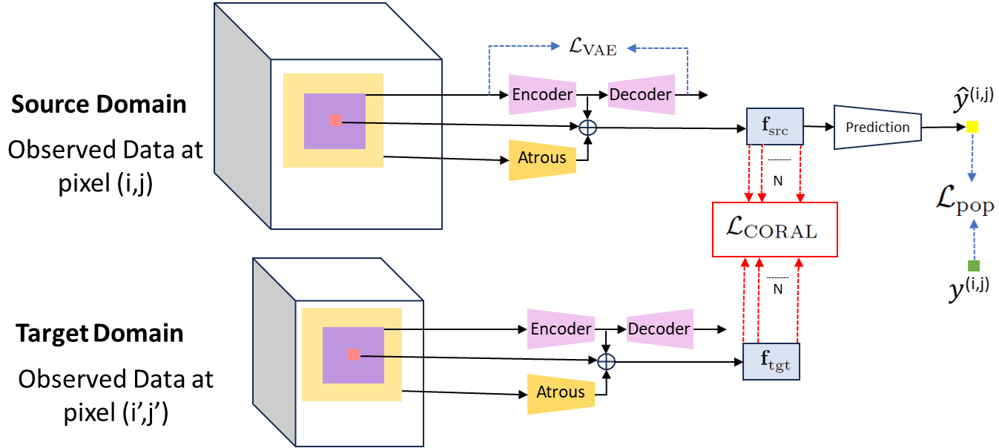

# CorPOP: Domain-Invariant Representation Learning via Second-Order Feature Alignment: Application to Geospatial Population Estimation

## 1. Introduction

This repository provides the implementation of **CorPOP**.

The location of the study areas (**Tunisia**) and (**Île-de-France**) is illustrated in the following figure:



---

# 2. Dataset

This section explains the **data assembly, preprocessing and transformation workflow** used in the study.  



The dataset consists of **population data** and several **ancillary datasets**.

---

# 2.1 Population Data

Three population datasets were used:

- WorldPop  
- INS (Institut national de la statistique – Tunisia)
- INSEE (L’Institut national de la statistique et des études économiques -France)

Original sources:

- WorldPop: https://hub.worldpop.org/doi/10.5258/soton/wp00536
- INS: https://www.ins.tn/statistiques/111
- INSEE:https://www.insee.fr/fr/statistiques/5351310

Because WorldPop dataset requires downloading **global rasters and extracting Tunisia**, we provide ready-to-use files.

File from google drive:

👉 [**`WorldPop Data/`**](https://drive.google.com/file/d/144qTJMNqwMi6JjsT-KorP9HB4IgxaWe5/view?usp=sharing)

Files uploaded in this repositry:

- ins_population.csv
- insee_population.csv 

Users can either download the original datasets or directly use the provided files.

---

# 2.2 Ancillary Data

## 2.2.1 Educational POI

Educational POIs include:

- Schools  
- Preparatory schools  
- Institutes  

The original tabular dataset download link is provided in the folder "Educational POI".

Because the source platform continuously updates the dataset (overwriting old versions),  
the exact version used in this study is also provided in the folder "Educational POI":POI.xls

Detailed workflow is provided in the folder 👉 [**`Educational POI/`**](https://github.com/IssaNasralli/popVAT/tree/main/Educational%20POI)

Final Raster KDE files (three files: KDE_Institute.tif, KDE_Preparatory_School.tif and KDE_School.tif) are available here: 👉 [Download](https://drive.google.com/file/d/1SuQS-xPlnfEbJ7ugH-FrqkZTjLAvFdV-/view?usp=sharing)

---

# 2.2.3 Land Use (LU)

Land Use data were extracted from **OpenStreetMap (OSM)**.

Download via HOT Export Tool:

https://export.hotosm.org/

LU data used in the study (polygons shapefile) are provided in the folder : 👉 [**`LU/`**](https://github.com/IssaNasralli/popVAT/tree/main/LU)


Rasterization of non-residential areas instructions are provided in the same folder.

---

# 2.2.4 Building Footprint

Original dataset: WSF2019  
https://download.geoservice.dlr.de/WSF2019/

Since the dataset is distributed as tiles, we provide the assembled Tunisia file: WSF2019.tif  👉 [Download](https://drive.google.com/file/d/1J0v0zZ0NSz3B5LQY5kWo04d__JzPMrGY/view?usp=sharing)

### Processing

1. WSF2019 was checked against the **non-residential binary mask**.
2. Building heights from WSF 3D were used.
3. Heights were reclassified:

Number of floors = pixel height / 3 meters

4. Floors were multiplied with the checked WSF2019 dataset.

Detailed steps are provided in the folder: 👉 [**`Building Foot print/`**](https://github.com/IssaNasralli/popVAT/tree/main/Buildin%20Foot%20Print)

Final dataset used in the study: Tunisia_floor_WSF2019_WGS_84_32N_0to1_residentiel.tif   👉 [Download](https://drive.google.com/file/d/1qPOQBsoA2vIOGjng7ZVT7OWqlF6S1oxa/view?usp=sharing)

---

# 2.2.5 Road Network

Road network data were extracted from **OpenStreetMap (OSM)**.

Processing:

1. Major roads were selected (excluding residential and service roads).
2. Batch Processing tool was used to snap road segments.
3. Intersect tool identified intersection points.
4. Point Density tool generated the raster layer.

Data used in the study are provided in the folder 👉 [**`Road Network/`**](https://github.com/IssaNasralli/popVAT/tree/main/Road%20Network)

Final dataset used in the study: road_densities_12128.tif   👉 [Download](https://drive.google.com/file/d/1VFsWsCtAvKQP5ZiUpeHONPsvq_HDS9ri/view?usp=sharing)


---

# 2.2.6 Satellite Imagery

Satellite imagery was obtained using **Google Earth Engine**.

Detailed workflow is provided in the folder  👉 [**`Satellite Imagery/`**](https://github.com/IssaNasralli/popVAT/tree/main/Satellite%20Imagery)

Final dataset used in the study: MODIS.tif   👉 [Download](https://drive.google.com/file/d/1mTkBDegUozfW1Ffla3Dv5yIhrBFuEGwF/view?usp=sharing)


---

# 2.2.7 LULC

LULC data were also obtained using **Google Earth Engine**.

Details are available in the folder 👉 [**`LULC/`**](https://github.com/IssaNasralli/popVAT/tree/main/LULC)


Final dataset used in the study: LULC.tif   👉 [Download](https://drive.google.com/file/d/1TUnvS1eyw--JxcGEyXqEAmc3b82ajoLW/view?usp=sharing)

---

# 2.2.8 GAUL

Administrative boundaries were obtained using **Google Earth Engine**.

Processing:

Each governorate boundary shapefile was converted to raster with:

Width: 3807  
Height: 8116  

Pixel values:

Inside boundary = 1

Outside boundary = 0

Details are available in the folder 👉 [**`GAUL/`**](https://github.com/IssaNasralli/popVAT/tree/main/GAUL)


For Tunisia: Files are provided in this repositry 👉 [**`Tunisia_Regions/`**](https://github.com/IssaNasralli/CorPOP/tree/main/Tunisia_Regions)
24 tif files (24 gouvernorates)

For France: Files are provided in this repositry 👉 [**`France_Regions/`**](https://github.com/IssaNasralli/CorPOP/tree/main/France_Regions)
8 tif files (8 gouvernorates)

---

# 2.2.9 DEM and Slope

Datasets obtained using **Google Earth Engine**.

Processing details in the folder [**`DEM and Slope/`**](https://github.com/IssaNasralli/popVAT/tree/main/DEM%20and%20Slope)

Final datasets:

dem.tif  and slope.tif

Final dataset used in the study: dem.tif and slope.tif are compreesed in one file  👉 [Download](https://drive.google.com/file/d/1QWDfKUUns6UzAl5zQU3J6j7ba8rO7Iqt/view?usp=sharing)

---

# 2.2.11 NTL

Nighttime light data were obtained using **Google Earth Engine**.

Details listed in the folder 👉 [**`NTL/`**](https://github.com/IssaNasralli/popVAT/tree/main/NTL)

Final dataset used in the study: Nighttime_Lights_Tunisia_2020.tif   👉 [Download](https://drive.google.com/file/d/1nDOA5-HVc2mT9du5E-cqIfn_mgDjYw_X/view?usp=sharing)


---

# 2.3 Creating the Final Multi-Band Dataset in ArcGIS Pro

The final dataset (`tunisia10.tif`) is produced by stacking all prepared raster layers into a single multi-band raster using ArcGIS Pro.

### Input rasters

The following raster layers are required:

- KDE_Institute.tif  
- KDE_Preparatory_School.tif  
- KDE_School.tif  
- Tunisia_floor_WSF2019_WGS_84_32N_0to1_residentiel.tif  
- road_densities_12128.tif  
- MODIS.tif (3 bands)  
- LULC.tif  
- dem.tif  
- slope.tif  
- Nighttime_Lights_Tunisia_2020.tif  

### Important preparation

Before stacking, make sure that all rasters:

- Use the same coordinate system (**WGS84 / UTM Zone 32N – EPSG:32632**)
- Have the same spatial resolution
- Are aligned to the same grid
- Cover the same geographic extent

If needed, use the following ArcGIS Pro tools:

- **Project Raster**
- **Resample**
- **Clip**
- **Snap Raster** (environment setting)

### Create the multi-band raster

1. Open **ArcGIS Pro**.
2. Go to **Analysis → Tools**.
3. Search for **Composite Bands**.
4. Add the rasters in the following order:

```
MODIS.tif
Nighttime_Lights_Tunisia_2020.tif
Tunisia_floor_WSF2019_WGS_84_32N_0to1_residentiel.tif
LULC.tif
dem.tif
slope.tif
road_densities_12128.tif
KDE_School.tif
KDE_Preparatory_School.tif
KDE_Institute.tif
```

5. Choose an output location.
6. Set the output name:

```
tunisia10.tif
```

7. Run the tool.

### Result

The generated raster contains **12 bands**:

- 9 single-band layers
- 1 MODIS raster containing **3 bands**

Total = **12 bands**.

This file corresponds to the dataset used for training and evaluation in the study.


# 2.4 Visualizing and Inspecting the Dataset in ArcGIS Pro

The final datasets (`tunisia10.tif`)  and (`france10.tif`) are a multi-band raster that can be easily explored using ArcGIS Pro.

### Step 1 — Download the dataset
Download the ready file (`tunisia10.tif`) from the link below and extract it if necessary.  👉 [Download](https://drive.google.com/file/d/12YaLwfOp-IPpgUMciMzb_lOR_eK4aL5B/view?usp=sharing)

Download the ready file (`france10.tif`) from the link below and extract it if necessary.  👉 [Download](https://drive.google.com/file/d/1T2pAUayDnHEmiLn8inYmh2OkjXFXrXTF/view?usp=sharing)


### Step 2 — Open ArcGIS Pro
Launch ArcGIS Pro and create a new project (Map project is sufficient).

### Step 3 — Add the raster dataset
1. In the **Catalog Pane**, click **Folders → Add Folder Connection**.
2. Navigate to the folder containing `tunisia10.tif`.
3. Drag and drop the raster into the map.

Alternatively:
Map → Add Data → Browse to `tunisia10.tif`.

### Step 4 — Inspect the bands
1. Right-click the raster layer.
2. Select **Properties**.
3. Go to the **Source** tab to view:
   - Number of bands
   - Pixel type
   - Spatial resolution
   - Coordinate system.

The dataset contains **10 bands** derived from the original 12 layers.

### Step 5 — Display individual bands
To visualize a specific band:

1. Right-click the layer → **Symbology**.
2. Choose **Singleband Gray** to inspect one band.
3. Select the band index (Band 1–10).

### Step 6 — Create RGB composites
To visualize multiple layers together:

1. Open **Symbology**.
2. Choose **RGB Composite**.
3. Assign bands to Red, Green, and Blue channels.

Example:
- R = Band 4  
- G = Band 3  
- B = Band 2  

This helps visually analyze spatial patterns.

### Step 7 — Extract band values
To inspect pixel values:

1. Go to **Explore Tool**.
2. Click anywhere on the raster.
3. Pixel values for all bands will appear.

### Step 8 — Export or process the raster (optional)
Users can run additional geospatial analysis:

Toolbox → Spatial Analyst → Raster Processing tools such as:
- Clip
- Reproject Raster
- Raster Calculator
- Zonal Statistics

### Notes
- Recommended coordinate system: **WGS84 / UTM Zone 32N (EPSG:32632)**.
- Make sure the raster is fully loaded before running analysis.

- 
---

# 3. CorPOP Architecture


Architecture diagram:




We present CorPOP, a domain-invariant deep learning framework that integrates unsupervised second-order feature alignment for cross-regional regression. Built on popVAT backbone, CorPOP fuses pixel-level and contextual representations while employing CORAL regularization to align the covariance structure of latent features between source and target domains. Trained on Tunisian data and evaluated on the Île-de-France region, the model achieves superior cross-domain generalization and reduced errors compared with non-adapted baselines. These results demonstrate how second-order domain adaptation can enhance geospatial population estimation and related transfer learning tasks.


Detailed explanation is available in the folder 👉 [**"Model architecture of popVAT"**](https://github.com/IssaNasralli/popVAT/tree/main/Model%20architecture%20of%20popVAT)


 
---


# 4. Training

## Dependencies

Make sure the following Python packages are installed:

```bash
tensorflow==2.15.0
numpy
pandas
scikit-learn
rasterio
```

Other requirements:

- Python ≥ 3.8
- GPU recommended for training (NVIDIA Tesla K80 or higher).
- Sufficient RAM for raster processing (≥32 GB recommended).

The **CorPOP** framework is implemented using **TensorFlow 2.15.0** and **Keras**, with auxiliary data processing handled by **Scikit-learn**. The model builds upon a Variational Autoencoder (VAE) backbone combined with an atrous convolution branch and incorporates CORAL-based domain adaptation for improved cross-regional generalization.

## Dataset

CorPOP is trained and evaluated using two distinct geographic domains:

- **Source domain:** Tunisia.
- **Target domain:** Île-de-France, France.

Both domains use the same population ground truth as in [5], namely WorldPop 2020 data (100 m resolution), complemented by census statistics from Tunisia's National Institute of Statistics (INS, 2020, governorate level).

The ancillary geospatial datasets consist of 10 feature bands, including:

- Land use
- Building footprints
- Road networks
- Points of Interest (POI)
- Land cover
- Elevation
- Slope
- Nighttime lights

Educational POI data for Île-de-France was collected from the [Open Data Platform for Education, Sports, and Youth](https://data.education.gouv.fr/). Administrative-level validation in Île-de-France relies on [INSEE's 2020 population counts](https://www.insee.fr/fr/statistiques/5351310).

The source-domain dataset (Tunisia) was randomly divided into:

- **50% training**
- **10% validation**
- **40% testing**

The target-domain data is used during training for unsupervised domain adaptation through feature alignment, without requiring target-domain population labels for the CORAL objective.

## Model Architecture

CorPOP adopts a dual-branch architecture combining:

- **VAE branch:** Extracts spatial contextual representations from medium-scale patches.
- **Atrous convolution branch:** Extracts contextual features from larger global patches.
- **Feature fusion:** Concatenates pixel-level ancillary features, VAE latent representations, and atrous features.
- **Prediction head:** Estimates population density from the fused feature representation.

To improve cross-domain generalization, CorPOP introduces a CORAL-based regularization mechanism that aligns the statistical distributions of source- and target-domain feature representations.

## Model Optimization

The model is optimized using the Adam optimizer with its default learning rate.

- **Optimizer:** Adam (default learning rate).
- **Training epochs:** 100.
- **Batch size:** 256 samples per domain.
- **Local patch size (p):** 11.
- **Global patch size (p_g):** 21.
- **Population regression loss:** Mean Squared Error (MSE).
- **VAE reconstruction loss:** Mean Squared Error (MSE).
- **VAE regularization:** Kullback–Leibler (KL) divergence.
- **Domain adaptation loss:** CORAL loss, aligning first- and second-order statistics between source and target feature distributions.

The overall training objective combines population regression, VAE regularization, and domain alignment:

$$
\mathcal{L} =
\alpha \mathcal{L}_{pop}
+\beta \mathcal{L}_{VAE}
+\gamma_t\mathcal{L}_{CORAL}
$$

where $\alpha$ and $\beta$ control the contributions of population prediction and VAE regularization, respectively, while $\gamma_t$ controls the strength of domain alignment.

## Domain Adaptation and Hyperparameter Tuning

Three experimental configurations were investigated:

1. **Baseline model:** Without CORAL alignment.
2. **Fixed CORAL:** Uses a constant domain adaptation weight ($\gamma$).
3. **Adaptive CORAL (proposed):** Dynamically adjusts the alignment strength according to the discrepancy between source- and target-domain feature distributions.

### Fixed CORAL Configuration

For the fixed CORAL configuration, the regularization weight was explored over:

- **$\gamma$:** 0.1–1.0 (step 0.05).

The optimal fixed CORAL configuration was obtained with:

- **$\gamma = 0.2$**

### Adaptive CORAL Configuration

For the proposed adaptive CORAL configuration, the adaptive coefficient is defined as:

$$
\gamma_t = \gamma_{\max}
\frac{D_t^2}{D_t^2+\kappa}
$$

where:

- $D_t^2$ represents the current source-target feature discrepancy.
- $\gamma_{\max}$ controls the maximum alignment strength.
- $\kappa$ controls the sensitivity of the adaptation mechanism.

The following hyperparameters were investigated:

- **Maximum alignment weight ($\gamma_{\max}$):** 0.1–1.0 (step 0.05).
- **Sensitivity parameter ($\kappa$):** 0.25$D_0^2$–2.0$D_0^2$ (step 0.25$D_0^2$).

The optimal adaptive CORAL configuration was obtained with:

- **$\gamma_{\max} = 0.65$**
- **$\kappa = 1.25D_0^2$**

where $D_0^2$ denotes the initial source-target feature discrepancy computed before CORAL alignment.

## Evaluation Metrics

Model performance is evaluated using three standard metrics:

- **Root Mean Squared Error (RMSE)**
- **Relative Error (RE)**
- **Coefficient of determination ($R^2$)**

Population predictions are aggregated over administrative units and compared against official census counts from INS (Tunisia) and INSEE (Île-de-France).

## Scripts and Configuration

Training scripts and configuration files are provided in the folder  👉 [**`Model Training of CorPOP/`**](https://github.com/IssaNasralli/CorPOP/tree/main/Model%20Training%20of%20CorPOP)\

---

# Citation

If you use this repository, please cite the corresponding publications of **CorPOP**,  **popVAT** and **popVAE**.

---
CorPOP:
```bash
@inproceedings{nasralli2026domaine,
  title={Domain-Invariant Representation Learning via Second-Order Feature Alignment: Application to Geospatial Population Estimation},
  author={Nasralli, Issa and Masmoudi, Imen and Drira, Hassen},
  booktitle={},
  pages={},
  year={},
  organization={}
}
```

popVAE:
```bash
@inproceedings{nasralli2025fine,
  title={Fine-Scale Population Estimation Using a Variational Autoencoder-Based Approach Integrating Geospatial Data},
  author={Nasralli, Issa and Masmoudi, Imen and Drira, Hassen and Taieb, Mohamed Ali Hadj},
  booktitle={2025 International Joint Conference on Neural Networks (IJCNN)},
  pages={1--8},
  year={2025},
  organization={IEEE}
}
```

popVAT:
```bash
@article{nasralli2026adaptive,
  title={Adaptive spatial feature fusion for fine-grained population estimation from multi-source geospatial data},
  author={Nasralli, Issa and Masmoudi, Imen and Drira, Hassen and Hadj Taieb, Mohamed Ali},
  journal={GeoInformatica},
  volume={30},
  number={2},
  pages={21},
  year={2026},
  publisher={Springer}
}
}
```
